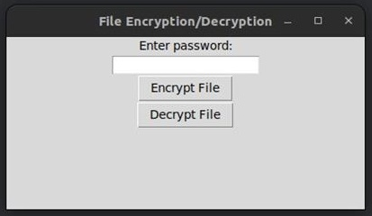
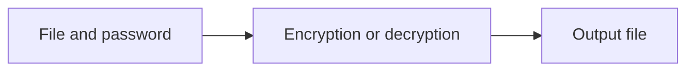

# File Encryption Tool

### A historical encryption/decryption prototype and recovered source variant.

**Python/Tkinter prototype documentation · Java source variant**

*Archived coursework / research prototype · Not actively maintained*

Project material for a password-driven file encryption interface. The presentation documents a Python GUI, while a separate recovered archive supplies Java encryption/decryption classes. Both are identified separately here.

*Historical Python GUI recovered from the presentation; separate from the Java source variant.*

## What is included

- Historical Encrypt File / Decrypt File interface
- Password-driven encryption workflow described in the report
- Recovered Java encryptor, decryptor, and entry point

The repository includes 3 directly browsable source/notebook files and a [source archive](source.zip) containing 3 files with their package structure preserved. See [SOURCE_INDEX.md](SOURCE_INDEX.md) for its contents. Reference components retain their labels and upstream notices.

## Workflow

*Diagram reconstructed from the recovered source or project description.*

## Preserved results and examples

These are historical artifacts, not fresh executions. Where a report includes scores or rankings, their original evaluation protocol has not been independently reproduced.

## Explore / run

Inspect `source.zip` for the recovered Java source tree. The Python GUI is documented by the screenshot, but its complete standalone source was not recovered in this group. Do not use this archived prototype to protect valuable data without reviewing its cryptographic construction and file handling.

### Direct source files

- [Decryptor.java](Decryptor.java)
- [Encryptor.java](Encryptor.java)
- [Main.java](Main.java)

## Project status

The screenshot and Java source are different recovered variants. This repository does not claim they form one tested application or provide production-grade encryption.

No training, benchmark, paid API request, or external service deployment was performed to prepare this showcase. Team names, student IDs, raw personal documents, and embedded credentials are excluded from the public upload copies. Additional scope notes are in [SOURCE_NOTES.md](SOURCE_NOTES.md).
